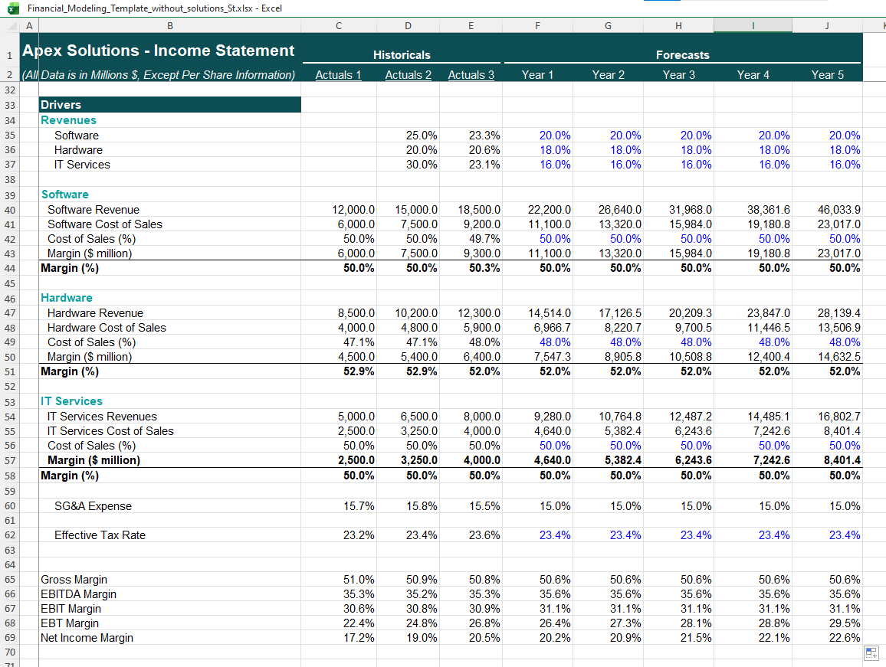
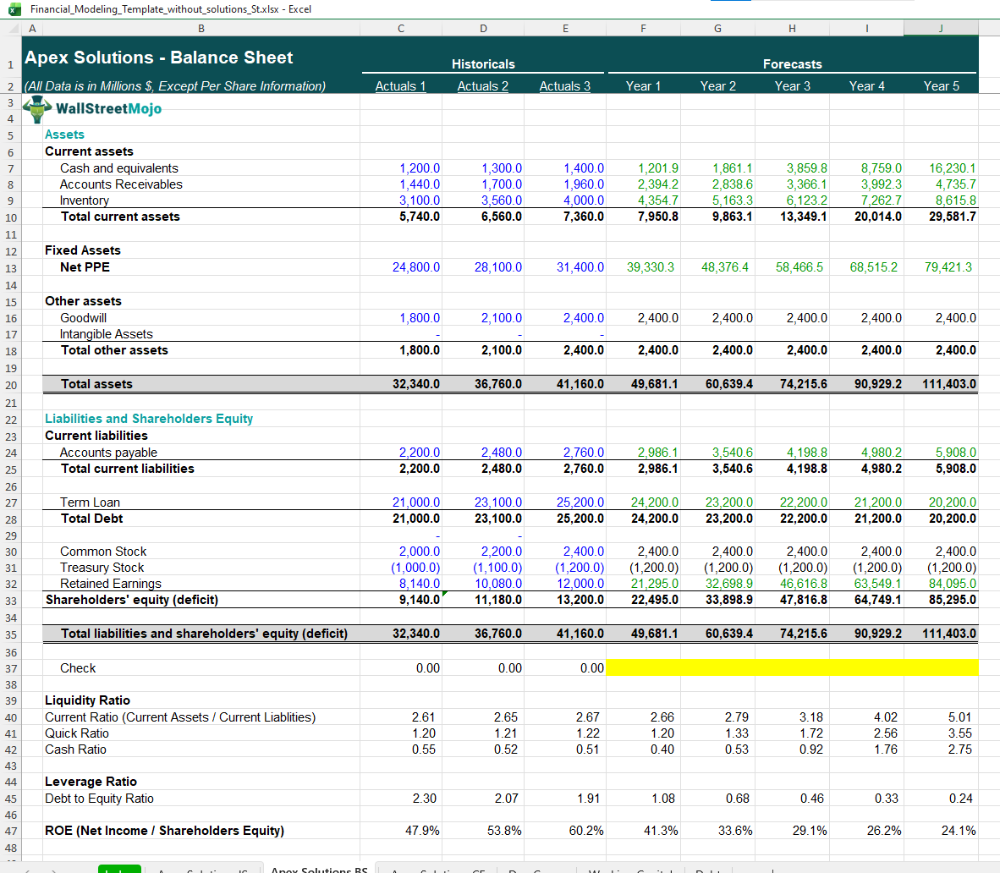

# Apex Solutions: Three-Statement Financial Model

A step-by-step financial forecasting model built in Excel, linking the
Income Statement, Balance Sheet and Cash Flow Statement over a
3-year historical and 5-year forecast period.

> Built as a learning project. The template and resources are from
> WallStreetMojo, and I learned the method under Dheeraj Vaidya.

## What this project covers

1. Creating the financial modeling structure
2. Analyzing the historical financials
3. Projecting revenues
4. Projecting costs
5. Projecting depreciation
6. Projecting working capital
7. Completing the Cash Flow Statement
8. Projecting debt
9. Balancing the Balance Sheet

## About the company

Apex Solutions is a sample company with three revenue streams:
Software, Hardware and IT Services. All figures are in millions of dollars.

## How the model works

- **Historicals:** 3 years of actuals (blue font = hard-coded inputs)
- **Forecasts:** 5 years, driven by assumptions
- **Revenue drivers:** annual growth rate for each segment
- **Cost drivers:** cost of sales % per segment, SG&A % of revenue,
  effective tax rate
- **Balance check:** assets minus (liabilities + equity) = 0.00 in every year

### Colour convention

| Colour | Meaning |
|--------|---------|
| Blue   | Hard-coded input / assumption |
| Black  | Formula |
| Green  | Link from another sheet |

## Key outputs

- Total revenue grows from $38,800M to about $90,976M by Year 5
- Net income grows from $7,950M to about $20,546M by Year 5
- The balance sheet balances in every forecast year
- Liquidity and leverage ratios improve as debt is paid down

## Screenshots

## What I learned

- A model is a chain of assumptions, so each one needs a reason
- Cash flow connects the income statement to the balance sheet
- The balance check is the fastest way to find a broken link

## Credits

- **Dheeraj Vaidya**: for the learning opportunity and guidance
- **WallStreetMojo**: for the template and resources

## Contact

Jipan, BBA (Finance & Banking) student, Chattogram, Bangladesh
Feel free to open an issue or message me on LinkedIn with feedback.
